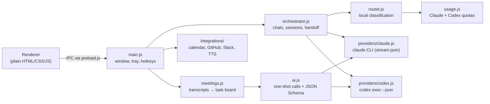

# Ohara

**English** | [Português](README.pt-BR.md)

Ohara is a Windows desktop assistant (Electron) that puts the Claude Code and Codex subscriptions you already pay for behind a single chat window for the whole PC. Both CLIs are strong on their own, but choosing the right model for each request and watching two separate usage quotas is tedious manual work. Ohara classifies every request locally, sends it to the provider, model and reasoning effort that fit the job, falls back to the other provider when a quota is running low, and carries the conversation context across when it switches. Around that core it turns meeting transcripts into a task board, runs instant local actions without spending tokens, and adds a few global hotkeys for working in any app.

## Technical highlights

- **Zero-token request router.** A keyword heuristic over normalized text sorts each prompt into one of nine categories (quick question, Windows command, code, complex code, web research, writing, planning, vision...) and maps it to a provider, model tier and effort level. Short follow-ups such as "go ahead" inherit the category of the conversation. → [`src/core/router.js`](src/core/router.js), [`test/router.test.js`](test/router.test.js)
- **Quota-aware fallback.** Claude usage (5-hour and 7-day windows) comes from the CLI's own reports; Codex usage is read from the `rate_limits` entries in `~/.codex/sessions`. Above 70% Claude usage, Opus is downgraded to Sonnet; above 90%, requests move to Codex, and code goes back to Claude when Codex passes 90%. All thresholds are configurable. → [`src/core/usage.js`](src/core/usage.js), [`src/core/config.js`](src/core/config.js)
- **Router that learns.** When you manually pick the same model for a category in 3 of your last 5 overrides, that choice becomes the new default for the category. → `learnPreferences` in [`src/core/router.js`](src/core/router.js)
- **Context handoff between providers.** Each conversation tracks how far every CLI session has read (`syncedUpTo`), so when Ohara switches from Claude to Codex (or back) it injects only the messages that provider has not seen. Expired sessions are retried from scratch with the transferred history, and a second request sent while an agent is working runs in parallel in its own session. → [`src/core/orchestrator.js`](src/core/orchestrator.js), [`test/orchestrator.test.js`](test/orchestrator.test.js)
- **CLI providers over streaming JSON.** Claude runs as `claude --output-format stream-json` with `--resume` for session continuity; Codex runs as `codex exec --json` inside a `workspace-write` sandbox. Tool calls are surfaced in the UI as they happen. → [`src/core/providers/claude.js`](src/core/providers/claude.js), [`src/core/providers/codex.js`](src/core/providers/codex.js), [`test/claude-args.test.js`](test/claude-args.test.js)
- **Structured output for background jobs.** One-shot calls pass a strict JSON Schema to either CLI (`--json-schema` / `--output-schema`). Background features run under their own budget: they use Claude up to 70%, then Codex up to 85%, and otherwise defer until the quota window resets, so the chat always has headroom. → [`src/core/ai.js`](src/core/ai.js)
- **Meeting pipeline.** Watches a folder for transcripts saved by a meeting bot, waits for the file to settle, merges reconnection parts, strips repeated speech-recognition lines, skips trivial calls, and extracts summary, decisions and action items into a Kanban board with deadlines, owners and "waiting on others" follow-ups. → [`src/core/meetings.js`](src/core/meetings.js), [`src/core/transcript.js`](src/core/transcript.js), [`test/meetings.test.js`](test/meetings.test.js)
- **Instant local actions.** Simple requests like "open Spotify" or "search Google for X" are resolved on the spot (apps are looked up in the Start menu) without calling any model. → [`src/core/quick-actions.js`](src/core/quick-actions.js)
- **Fix text anywhere.** A global hotkey copies the current selection in any app, corrects spelling, accents and punctuation with AI while keeping the writer's style, and pastes it back, restoring the original clipboard afterwards. Electron and Windows are injected, so the logic is unit-tested. → [`src/core/text-fix.js`](src/core/text-fix.js), [`test/text-fix.test.js`](test/text-fix.test.js)
- **Safety defaults.** Claude runs in `--permission-mode auto` and Codex in `workspace-write`; full access is an explicit toggle. The Slack token and calendar URL are encrypted with Electron `safeStorage` (Windows DPAPI) and never reach the renderer. → [`src/main.js`](src/main.js)

Integrations: Google Calendar via secret iCal URL ([`calendar.js`](src/integrations/calendar.js)), GitHub PRs through the logged-in `gh` CLI ([`github.js`](src/integrations/github.js)), Slack DMs and mentions ([`slack.js`](src/integrations/slack.js)), and spoken replies with Edge neural voices plus an offline Windows fallback ([`tts.js`](src/integrations/tts.js)).

## Architecture



```
src/
  main.js            Electron main process: window, tray, global hotkeys, screen capture, IPC
  preload.js         safe bridge between renderer and main
  core/              router, orchestrator, usage, providers, meetings, automations, insights
  integrations/      calendar, GitHub, Slack, TTS and other external services
  renderer/          UI (plain HTML/CSS/JS, no framework)
test/                node:test suites
```

## Running and testing

Requirements: Windows 10/11, Node.js, and the `claude` and `codex` CLIs installed and logged in (`claude`, `codex login`).

```powershell
npm install
npm start        # launch the app (it lives in the system tray)
npm run dev      # same, with DevTools
npm test         # node --test test/*.test.js
npm run dist     # build the NSIS installer and portable .exe into dist\
```

The test suite uses Node's built-in test runner (no extra framework): 126 tests across 20 files covering the router, orchestrator, providers, meetings, transcript cleanup, text fix, storage and configuration.

Prebuilt installers are available on the [Releases](https://github.com/Gabs-X/ohara/releases/latest) page. The executables are not code-signed, so SmartScreen may warn on first launch.

Ohara is a personal tool, so some defaults point to the author's folders (workspace root, meeting transcripts, its own repository). Any key in [`src/core/config.js`](src/core/config.js) can be overridden in `%APPDATA%\Ohara\config.json`.

## Status

Actively developed and used daily by the author. Since v0.6.10 the app ships as a slimmer, stability-focused build: WhatsApp messaging and voice input (local Whisper dictation and the wake word) are disabled in [`simplifyConfig`](src/core/config.js), while spoken replies keep working. The code for those features is still in `src/integrations/`.

The name comes from Ohara, the island of scholars and its great library in *One Piece*. The app was called "Central IA" up to v0.3.
